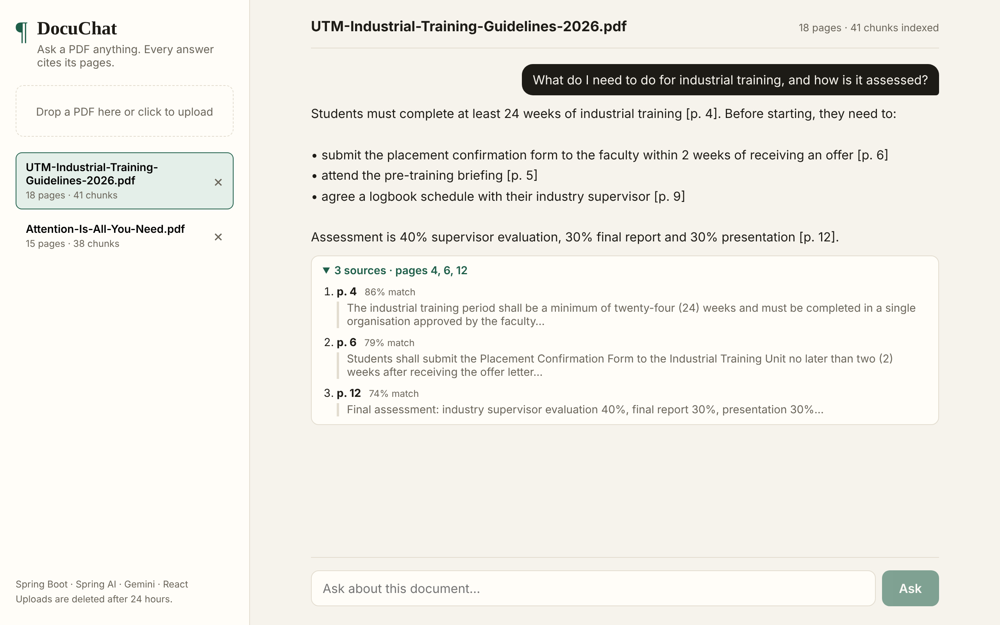

# ¶ DocuChat: chat with your PDFs

[](https://github.com/Mohamedarshathsaleem/docuchat/actions/workflows/ci.yml)


**Upload a PDF and ask questions in plain English. DocuChat answers *only* from the document and cites the page behind every fact.** It's a retrieval-augmented generation (RAG) app built with Spring Boot, Spring AI and Google Gemini.

<!-- TODO(Arshath): replace with your Render URL after deploying -->
🔗 **Live demo:** _coming soon_


<sub>UI preview with sample data.</sub>

---

## ✨ What it does

- **Grounded answers with citations.** Each fact is tagged `[p. 4]`, and the exact passages used are shown with their similarity scores.
- **No answer is better than a made-up one.** If nothing in the document is relevant, the model isn't called and DocuChat says so.
- **Scoped retrieval.** Searches are filtered to the selected document, so other people's uploads can't leak into your answer.
- **Built for a public demo.** Per-IP rate limiting protects the free Gemini quota, uploads are capped at 5 MB / 50 pages, and documents are deleted automatically after 24 hours.
- **One container.** The React app is bundled into the Spring Boot jar, with no separate database to run.

## 🏗️ How it works

```
                    ┌───────────────────────── INGEST ─────────────────────────┐
  PDF upload ──▶ PagePdfDocumentReader ──▶ TokenTextSplitter ──▶ Gemini embeddings ──▶ Vector store
                 (1 document per page,     (~400-token chunks,     (gemini-embedding-001)   (+ docId, page
                  page number kept)          metadata copied)                                metadata)

                    ┌────────────────────────── ASK ───────────────────────────┐
  Question ──▶ embed ──▶ top-5 similar chunks ──▶ none relevant? ──▶ "couldn't find it" (no LLM call)
                         WHERE docId = :doc            │
                                                       ▼
                         numbered, page-labelled context + grounding rules ──▶ Gemini 2.5 Flash
                                                                                    │
                                              answer with [p. n] citations + sources ◀┘
```

The RAG flow is written out explicitly in [`RagService`](backend/src/main/java/com/arshath/docuchat/chat/RagService.java) rather than hidden behind a framework advisor, so every step can be read and tested.

### Design decisions

| Decision | Why |
|---|---|
| Gemini through its **OpenAI-compatible API** with Spring AI's OpenAI client | Free tier, and changing provider (OpenAI, Groq, Ollama) is a config change rather than a code change |
| **SimpleVectorStore** persisted to JSON | Zero infrastructure for a demo. The code depends on the `VectorStore` interface, so moving to pgvector means swapping one bean |
| **Page-per-document reading** before chunking | Every chunk keeps its page number, which is what makes citations possible |
| **Similarity threshold + early exit** | Reduces hallucination and saves quota on off-topic questions |
| **Prompt-injection guard** in the system prompt | Passages are treated as data, so text inside a PDF can't override the instructions |
| **RFC 7807 problem responses** | Consistent, frontend-friendly errors with no stack traces leaked |

## 🛠️ Tech stack

| Layer | Technology |
|---|---|
| Backend | Java 21, Spring Boot 3.5, Spring AI 1.0, Apache PDFBox |
| AI | Google Gemini 2.5 Flash (chat), gemini-embedding-001 (embeddings) |
| Frontend | React 18, TypeScript, Vite |
| Testing | JUnit 5, AssertJ, MockMvc, Vitest, Testing Library |
| DevOps | Docker (multi-stage), GitHub Actions, Dependabot, Render |

## 🚀 Run it locally

You need a free Gemini API key from [Google AI Studio](https://aistudio.google.com/apikey).

**With Docker (easiest):**

```bash
git clone https://github.com/Mohamedarshathsaleem/docuchat.git
cd docuchat
cp .env.example .env        # paste your GEMINI_API_KEY
docker compose up --build   # http://localhost:8080
```

**For development (hot reload):**

```bash
# terminal 1: API on :8080 (Java 21 + Maven)
cd backend
GEMINI_API_KEY=your-key mvn spring-boot:run

# terminal 2: UI on :5173, proxied to the API
cd frontend
npm install
npm run dev
```

## 🧪 Tests

```bash
cd backend && mvn verify     # ingestion, RAG, rate limiting, API validation (no API key needed)
cd frontend && npm test      # chat and upload components
```

The backend tests run fully offline. A deterministic fake embedding model and a fake chat model let them check real behaviour: the right page is retrieved, the model isn't called when nothing matches, and results never cross documents.

## ☁️ Deploy (free)

1. Push to GitHub, then in [Render](https://render.com) choose **New → Blueprint** and select this repo (it reads `render.yaml`).
2. Set `GEMINI_API_KEY` when prompted.
3. Wait for the first build (~5 min). The free instance sleeps when idle, so the first request after a break takes ~30 s.

Free instances have no persistent disk, so documents also disappear on restart. That's fine for a demo.

## 📡 API

| Method | Endpoint | Body | Returns |
|---|---|---|---|
| POST | `/api/documents` | multipart `file` (PDF) | `{ id, filename, pages, chunks, uploadedAt }` |
| GET | `/api/documents` | – | list of documents |
| DELETE | `/api/documents/{id}` | – | 204 |
| POST | `/api/chat` | `{ documentId, question }` | `{ answer, sources: [{ page, excerpt, score }] }` |
| GET | `/actuator/health` | – | health check |

## 🧭 Roadmap

- [ ] Stream answers token by token (Server-Sent Events)
- [ ] pgvector profile with Docker Compose
- [ ] Hybrid search (BM25 + vectors) and re-ranking
- [ ] Multi-turn chat memory
- [ ] An evaluation set measuring answer faithfulness over sample PDFs

## 📄 License

[MIT](LICENSE) © 2026 Mohamed Arshath
